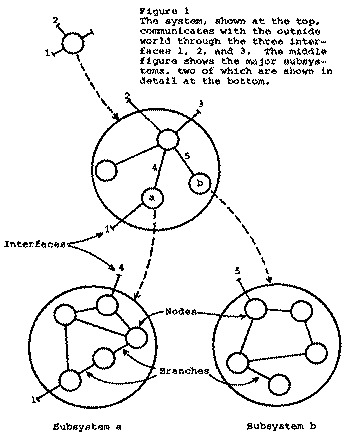
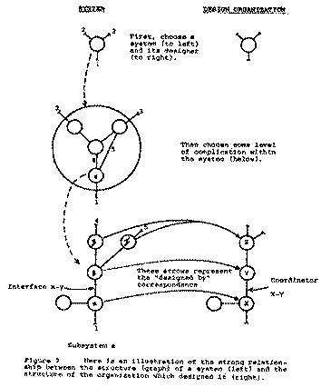
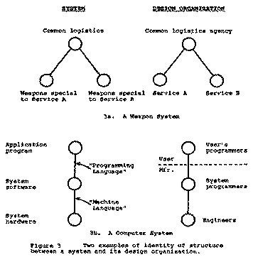

原文：[How Do Committees Invent?（PDF）](https://www.melconway.com/Home/pdf/committees.pdf) · [作者官网文字版](https://www.melconway.com/Home/Committees_Paper.html)

*注意：本文翻译仅供个人学习，未获原作者或版权方授权。作者前言依据官网文字版译出，与 1968 年发表的论文正文分列。*

## 发表 42 年后，作者的话

这篇论文最令人惊讶的地方，或许在于：核心论点直到倒数第三段才出现，它竟然还是发表了。为了省去你读过 45 个段落才找到论点的麻烦，我先用不那么正式的方式把它告诉你：

> 任何设计系统的组织（这里的“系统”不只指信息系统，而是更广义的概念），都不可避免地会产生这样的设计：其结构是该组织沟通结构的副本。

人们通常在软件工程领域引用这一原则，但事实证明，它的适用范围远不止于此。我邀请你读一读这篇论文，再看看身边有哪些地方可以应用它。我目前最感兴趣的是围绕美国贫困问题的一系列复杂社会议题：进入劳动力市场的机会、住房、教育和医疗服务。读完本文后，不妨想一想：各级政府的组织结构，会怎样影响它们处理这一系统的方式？

## 委员会如何发明？

作者：Melvin E. Conway（梅尔文·E. 康威）

版权归 F. D. Thompson Publications, Inc. 所有，1968 年。经《Datamation》杂志许可转载，原文发表于该刊 1968 年 4 月号。

将不同部分组合成一个有用整体的智力活动，可以称为系统设计。无论是为大型武器系统制定规格、提出应对社会挑战的建议，还是编写计算机程序，这些活动的基本过程都大致相同。

设计组织的目标，通常是编制一份文档，将相关信息组织成结构连贯的整体。我们可以把这些信息称为“系统设计”。这份设计通常是为某个发起方制作的，后者希望以它为指导开展某项活动。例如，一位公职人员可能希望通过立法，避免近期发生的灾难重演，于是任命一个团队调查灾难的原因；或者，一家制造商需要推出新产品，于是安排产品规划工作，明确应该推出什么。

设计组织不一定参与其所设计系统的构建。在公共事务中，常有政策不鼓励某个团体自行实施它提出的建议；而在私营企业中，情况往往恰好相反。

可以合理地推测：设计者知道自己的建议将由自己执行，还是由别人执行，会影响他必须作出的某些设计选择。大多数设计活动都需要不断作出选择。其中许多选择不只是设计决策，也可能是设计者对自身未来作出的个人决定。正如后文将要说明的，传统管理环境中的激励机制，可能促使设计者作出违背发起方意图的选择。[1]

### 设计的阶段

设计工作的初始阶段，更多关注的是如何组织设计活动，而不是系统本身。[2] 只有完成某些前期准备，全面的设计工作才能展开。这些准备包括：

1. 理解发起方和现实条件为设计活动及待设计系统划定的边界；
2. 对系统的组织方式形成初步构想，以便合理地分配设计任务、安排任务小组。

后文将详细说明：组建设计团队这一行为本身，就意味着某些设计决策已经作出，无论这些决策是否被明确表达。对于任何一种设计团队的组织方式，总有一类备选方案无法得到有效探索，因为团队中不存在探索它们所需的沟通路径。因此，不存在既有组织、又对设计方案毫无偏向的设计团队。

设计团队的组织方式一旦确定，就可以把各项工作委派给下属小组。每一次委派，在缩小某个人探索范围的同时，也缩小了能够得到有效探索的设计方案范围。

各组的工作范围一旦划定，协调问题也就随之产生。任务小组之间的协调，看似会降低小组内个人的生产率，却是各组将成果整合为统一系统设计的唯一途径。

因此，系统设计工作的生命周期通常经历以下阶段：

1. 根据基本规则划定边界；
2. 选择初步的系统构想；
3. 根据这一构想组织设计活动、委派任务；
4. 协调各项已委派的任务；
5. 将各部分设计整合为一份完整设计。

具体的设计活动未必会按这个顺序一路进行下去。在发现一个显然更优的新设计构想后，团队也可能重新组织工作。但这种不确定性会让团队显得不够可靠，而主动放弃已有成果，本身也令人痛苦、代价高昂。当然，从历史的角度看，这个过程始终在重复。由此便有了这样的感慨：**从来没有足够的时间把事情一次做好，却总有足够的时间重做一遍。**

### 被设计的系统

任何重要的系统，都由相互连接的较小子系统构成。要描述系统内部如何运作，就必须说明它与外部世界的联系，明确各个子系统，以及它们之间的连接方式。再往下一层，把每个子系统视作一个系统，同样的描述方法仍然适用。我们可以不断缩小考察范围，直到某个系统已经足够简单，无需继续拆分就能理解。

**例子。** 一个横贯大陆的公共交通系统，包括公共汽车、火车、飞机、各类通行路权、停车场、出租车、交通枢纽等。这是一个高度异构的系统，也就是说，它的子系统多种多样。再往下一层看，以飞机为例，它可能包含机体结构、推进、配电、通信以及有效载荷装载等子系统。推进子系统又包含燃料、点火、启动等子系统。

或许不那么显而易见的是：理论在同样的意义上也是一个系统。理论与外部世界中被观察到的事件相关联，必须能够解释这些事件，至少不能与它们相矛盾。理论由若干子理论组成，这些子理论之间也必须以同样的方式相互关联。例如，空难调查试图建立一个解释复杂事件的理论，其中可能包含描述飞机航迹、无线电通信、损坏方式，以及事发时飞机与附近物体关系的多个子理论。每个子理论本身又是一段叙述，可以继续拆解为更细的内容，直至单项证据的层面。

**用图表示系统。** 图 1 用节点和边来表示上述系统观，就像用 Tinker-Toy 拼装玩具搭成的结构：线条是边，圆圈是节点。每个节点代表一个子系统，子系统沿着边与其他子系统通信。每个子系统内部，又可能包含一个可以用类似方式表示的结构。系统领域日益流行的“接口”一词，指的就是图 1 中用线条表示的子系统间通信路径，也就是边。接口也可以指插头或法兰之类的连接件，将从两个节点引出的路径连接起来。

### 组织与系统的关系

这种图示方法之所以有用，是因为它为我们正在考察的两类对象——设计组织及其设计的系统——提供了形式相同的抽象。只要在图 1 中作如下替换，就能说明这一点：

1. 将“系统”替换为“委员会”；
2. 将“子系统”替换为“子委员会”；
3. 将“接口”替换为“协调员”。

与系统一样，设计团队也可以在不同的复杂层级上加以考察。例如，美国联邦政府就是一个很好的设计组织实例，其复杂程度足以满足任何系统工程师的研究兴趣。这个例子尤其适合说明两类对象的相似性：联邦政府既是一个设计组织，负责设计法律、条约和政策；又是一个被设计的系统，而宪法就是它最主要的初步设计文档。

**一种基本关系。** 现在，我们可以讨论本文的根本问题了：设计组织的图结构，与它所设计系统的图结构之间，是否存在可预测的关系？答案是肯定的。这种关系非常简单，在某些情况下，两者甚至完全一致。请看下面的“证明”。

任意选取一个系统及设计它的组织，再任意选取该系统的某个复杂层级，为它画出一张图。（之所以任意选取，是因为如果我们能证明某种有意义的关系，它就应当适用于任何设计组织和任何复杂层级。）图 2 仅用于示意，后面的论述可以结合图中的结构来理解。

对于系统中的任意节点 x，我们都可以在设计组织中找到设计它的小组，将这个小组记作 X。把这一过程推广到整个系统，就得到了一条规则：为系统中的每个节点，找出设计组织中的对应节点。注意，这种对应不一定是一对一的；两个子系统可能由同一个小组设计。

有趣的是，对边也可以作出类似的论述。任取系统中的两个节点 x 和 y，它们之间要么有边，要么没有。（也就是说，它们要么以某种对系统运行有意义的方式通信，要么不通信。）如果存在一条边，设计这两个节点的两个小组 X 和 Y（它们未必是不同的小组）就必须协商并约定接口规格。为此，设计组织中的这两个对应节点之间必须能够沟通。反过来，如果 x 和 y 之间没有边，两个子系统就不通信，相应的设计小组也没有需要协商的事项，因此 X 和 Y 之间也没有边。[3]

我们刚才说明了什么？概括地说，系统结构与设计它的组织结构之间，存在非常密切的关系。如果每个子系统都由一个独立小组设计——这种情况并不少见——那么设计团队与系统的结构，也就是它们的图结构，完全一致。如果某个小组设计了多个子系统，那么设计组织的结构就是系统结构的一个折叠版本：由同一小组设计的子系统，被合并为一个代表该小组的节点。

两组事物之间这种保持结构的关系，称为**同态**。用数学家的语言说，就是从系统的图到其设计组织的图，存在一个同态映射。

### 系统是设计团队的映像

经验丰富的系统设计者笃信：无论给出怎样的系统设计，总有一天会有人找到一个更好的设计，完成同样的工作。换言之，除非放在空间、时间、知识和技术的具体背景中理解，否则，把某个方案称为完成一项特定工作的“那个设计”，既不准确，也会误导人。对于读过历史或回顾过自身经历的人来说，这一信念所要求的谦逊，才是系统设计者应有的态度。

FORTRAN、COBOL 等编程语言的编译器在设计上的演进，就是一个例子。20 世纪 50 年代中期，这些语言的原型刚出现时，它们的编译器甚至比运行它们所需的计算机还要笨重，而那些计算机在当时已经称得上庞然大物。如今，这些早期编译器只是历史上的奇物，其设计与今天的编译器已大不相同。（尤其值得注意的是，编译器设计上的飞跃，与新的团队进入一个先前主要由计算机制造商涉足的领域有关：先是规模小、合作紧密的大学研究团队，随后是独立的软件公司。）

如果我们可以合理地假定，对于任何系统需求，都有一组能够满足它的设计方案，那么还必须追问：选择怎样的设计组织，会不会影响从这些方案中选出最终设计的过程？如果认可前面论述的同态关系，就必须承认答案是肯定的。一个组织的沟通结构越缺乏灵活性，它就越会在自己产出的每份设计中留下自身结构的映像。组织越大，灵活性越低，这种现象也就越明显。

**例子。** 一家承接研究合同的机构，有八个人负责开发 COBOL 和 ALGOL 编译器。在初步估计任务难度和所需时间后，五个人被分配去开发 COBOL 编译器，三个人去开发 ALGOL 编译器。结果，COBOL 编译器分为五个处理阶段，ALGOL 编译器分为三个。

两个军种奉总司令之命，开发一套满足各自需求的通用武器系统。费了很大力气之后，它们做出来的却是自身组织结构图的翻版。（见图 3a。）

再看一个正在运行、用于解决某个问题的计算机系统。从较高层级来看，它由硬件、系统软件和应用程序三部分组成。（见图 3b。）与这些子系统相对应的，是各自的设计者：计算机制造商的工程师、制造商的系统程序员，以及用户一方的应用程序员。（系统硬件与软件能够相互配合，而不只是勉强兼容的情况并不多见；这些少见的情况，往往出现在程序员与工程师也能以类似方式合作的制造商中。）

### 系统管理

大型系统的结构在开发过程中往往会趋于瓦解，而且这种倾向比小型系统更为明显。过去十余年间的大型军事信息系统，尤其鲜明地体现了这一现象；它们是人类头脑构想出的最复杂的事物之一。“系统管理”这项活动的兴起，部分原因正是为了应对系统结构瓦解的倾向。下面来看看，前文提出的概念对系统管理有什么用处。

为什么大型系统会瓦解？这一过程似乎分为三步，其中前两步可以控制，第三步则是同态关系的直接结果。

- 首先，最初的设计者意识到系统规模将会很大，再加上组织内部的某些压力，难以抵挡向设计工作投入过多人员的诱惑。
- 其次，将传统的管理经验应用于大型设计组织，导致其沟通结构瓦解。
- 最后，同态关系使系统结构也反映出设计组织中已经发生的瓦解。

先来看设计工作中人员投入过多的倾向。当系统呈现出的复杂程度逼近最初设计者的理解极限时，他自然会想把任务委派出去。这里的“最初设计者”，指的是其初步设计构想会影响设计工作组织方式的人。这是设计过程中的转折点：他要么努力简化系统，使之重新变得可以理解，并取得成功；要么就失去对系统的控制。如果既有进度压力，又有需要管理的预算，结果几乎可以预见。

管理者知道，如果没有动用全部资源就没能按期完成工作，他很容易被指责管理不善。这给最初的设计者带来了巨大压力。他或许更愿意继续钻研设计，而不是通过委派将其割裂开来，但周围的环境会让他觉得，冒这个险的代价实在太高。因此，他被迫委派任务，以便投入更多资源。

下面的例子说明了另一种相关情形：管理者所处的环境，可能与待设计系统的整体性发生冲突。

一位管理者必须把一项关键而困难的设计任务分包出去。他有两个承包商可选：一个是新成立的小型组织，提出的方案直观上很有吸引力，报价也远低于预算；另一个是老牌机构，做法较为传统，要求的费用则更“现实”。他知道，如果这个充满潜力的新组织没能交出合格成果，他就会被指责管理不善；但如果老牌机构失败，人们却会认为，这恰好证明了问题确实很棘手。

这里的问题是什么？很大一部分在于，传统会计理论所衍生的资源衡量方式。按照这种理论，资源的计量单位是美元，所有资源都必须用能够换算为美元的单位来衡量。如果资源是人力投入，就把每个人的工作时数乘以其每小时成本，再对所有人员求和。

这种计算背后的一个谬误，是假定资源具有**线性**关系：在每人每小时成本相同的情况下，两个人工作一年，与一百个人工作一周，被视为价值相等的资源。两个人和一百个人不可能以同样的组织结构开展工作——这一点直观上就很明显，后文还会讨论。根据同态关系，他们不会设计出相似的系统，因此，他们投入的价值甚至可能无法直接比较。经验告诉我们，如果那两个人选得合适，也熬得过这个过程，他们会给我们一个更好的系统。对削土豆皮、砌砖墙或许适用的假设，并不适用于系统设计。

帕金森定律 [4] 在设计工作投入过度的问题中起着重要作用。只要管理者的声望和权力与其预算规模挂钩，他就有动力扩大组织。对于系统设计活动的管理来说，这是一种不恰当的动机。当然，组织一旦建立，就总会被派上用场。如今许多设计糟糕的系统背后，最大的共同因素或许就是：恰好有一个需要工作可做的设计组织。

系统设计瓦解的第二步——设计组织沟通结构的碎片化——从任务开始委派时就启动了。初等概率论告诉我们，组织中潜在沟通路径的数量，大约等于人数平方的一半。即使组织规模不算大，也有必要限制沟通，好让人们能完成一些“工作”。因此，研究如何让设计者之间更高效地沟通，对于系统管理技术将极为重要。

常见的管理实践，对军事式组织的管理结构图施加了某些数量限制。具体而言，每个人至多有一位上级，下属人数最多约为七人。如果组织规程要求沟通沿着指挥链进行，那么组织的沟通结构就会类似于它的管理结构。这也是军事式组织设计出的系统往往像其组织结构图的原因之一。

### 结论

本文的基本论点是：**设计系统的组织（这里的“系统”取广义），受其沟通结构的制约，只能产生与该沟通结构相对应的设计。** 我们已经看到，这一点对系统设计的管理有着重要意义。首先，它为设计组织的结构安排提供了一条准则：**设计工作应当按照沟通的需要来组织。**

这条准则也带来了难题，因为任何时刻的沟通需求，都取决于当时采用的系统构想。最先出现的设计几乎从来不是最优设计，因此，当前的系统构想可能需要改变。也正因如此，组织的灵活性对于有效的设计至关重要。

我们必须找到办法，奖励那些让组织保持精简和灵活的设计管理者。系统设计管理需要一种新的理念，而不是建立在“增加人手就能直接提高生产率”的假设之上。发展这样的理念，有望揭示有关资源价值和沟通技术的根本问题；只有回答这些问题，我们构建系统的技术才能有把握地继续向前发展。

### 注释

[1] John Kenneth Galbraith 的《新工业国》（The New Industrial State，波士顿：Houghton Mifflin，1967 年）对系统设计组织的行为作了相关但更为全面的讨论。尤其参见第六章“技术结构”（The Technostructure）。

[2] 关于在职能型组织环境中，以项目形式开展设计活动可能遇到的问题，参见 C. J. Middleton 的《如何建立项目组织》（How to Set Up a Project Organization），《哈佛商业评论》，1967 年 3—4 月，第 73 页。

[3] 这一说法可以从几个角度理解。它可能只是一个取决于“有意义的协商”如何定义的显然结论；也可能来自这样一种观察：除非绝对必要，一个设计小组几乎从不会为了满足另一个小组的需要，而对自己的设计作出妥协。

[4] C. Northcote Parkinson，《帕金森定律及其他行政管理研究》（Parkinson's Law and Other Studies in Administration，波士顿：Houghton Mifflin，1957 年）。
